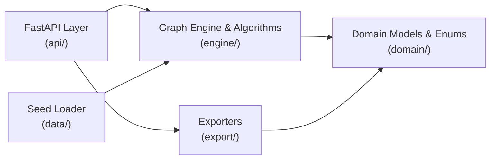
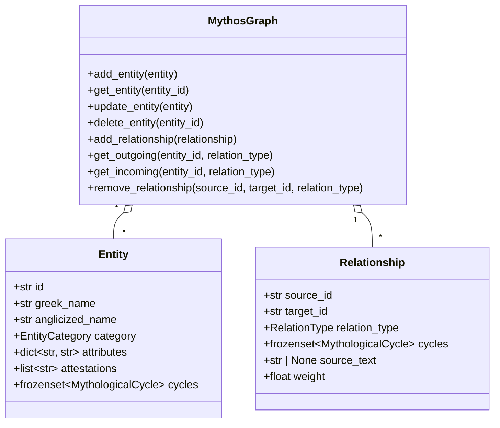
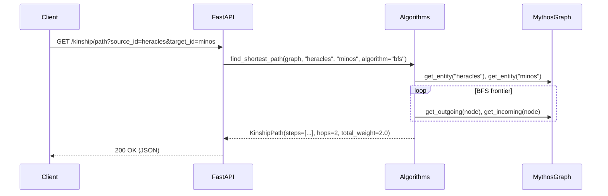

# MythosGraph — Minimal System Design

## 1. Architecture Overview

MythosGraph is structured in four layers with one-way dependencies:

- **domain**: Pydantic models (`Entity`, `Relationship`) and enums (`EntityCategory`, `RelationType`, `MythologicalCycle`).
- **engine**: In-memory directed multigraph (`MythosGraph`) using outgoing and incoming adjacency lists, plus traversal algorithms (BFS, Dijkstra, bounded lineage extraction, cycle filtering).
- **data**: JSON seed loader for initial Greek mythology data.
- **export**: Serializers for JSON Graph Format (JGF) and Graphviz DOT.
- **api**: FastAPI application exposing CRUD, queries, and export endpoints with automatic OpenAPI/Swagger documentation.

## 2. Core Data Model

## 3. Kinship Query Flow

Example request: finding the shortest kinship path between Heracles and Minos.

## 4. Key Design Decisions

- **Dual adjacency lists (`_outgoing`, `_incoming`)**: Allows `O(1)` lookup of both parent and child links without scanning the full graph.
- **Bidirectional kinship traversal**: Kinship queries default to traversing both outgoing and incoming edges so shared-ancestor paths (e.g., `Heracles <- Zeus -> Minos`) are found naturally. Strict directed traversal is available via `bidirectional=false`.
- **Cycle safety**: Greek mythological genealogies contain cycles across generations. Both shortest-path search and depth-bounded lineage extraction track a `visited` set so every node is expanded at most once.
- **In-memory prototype state**: On startup, the API loads `hellenic_seed.json` into memory. Persistent storage is out of scope for the prototype.

## 5. Prototype REST Endpoints

| Method | Path | Purpose |
| :--- | :--- | :--- |
| `GET` | `/health` | Service status check |
| `GET` | `/stats` | Node and edge counts |
| `GET` | `/entities` | List entities (optional `category` filter) |
| `POST` | `/entities` | Create an entity |
| `GET` | `/entities/{entity_id}` | Fetch entity details |
| `DELETE` | `/entities/{entity_id}` | Delete an entity and incident edges |
| `POST` | `/relationships` | Create a directed relationship |
| `GET` | `/kinship/path` | Shortest path (`bfs` or `dijkstra`) |
| `GET` | `/entities/{entity_id}/lineage` | Ancestor/descendant subgraph up to `depth` |
| `GET` | `/cycles/{cycle}` | Filter subgraph by mythological cycle |
| `GET` | `/export/jgf` | Export graph or cycle subgraph as JGF JSON |
| `GET` | `/export/dot` | Export graph or cycle subgraph as Graphviz DOT |
